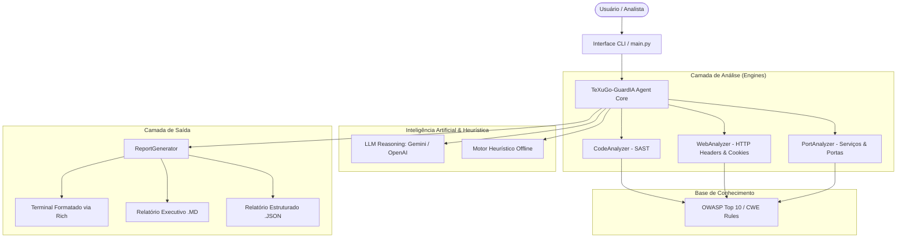

# 🛡️ TeXuGo-GuardIA: Agente Inteligente para Cibersegurança e Análise de Vulnerabilidades


> Projeto desenvolvido como solução para o Desafio de Projeto **"GuardAI: Agente Inteligente para Cibersegurança e Análise de Vulnerabilidades"** da formação em Cibersegurança da **DIO (Digital Innovation One)** em parceria com o **Santander**.

---

## 📌 Visão Geral do Projeto

O **TeXuGo-GuardIA** é um agente autônomo inteligente projetado para auxiliar analistas de segurança da informação, desenvolvedores e equipes de DevOps/SecOps na identificação precoce, triagem e remediação de falhas de segurança. 

O agente une técnicas modernas de **Análise Estática de Código (SAST)**, **Auditoria de Superfície Web e Headers HTTP**, e **Varredura Heurística de Portas e Serviços**, integrando modelos de Inteligência Artificial generativa (**Google Gemini** ou **OpenAI**) para contextualizar o risco e fornecer planos técnicos de remediação e código defensivo seguro.

---

## 🏗️ Arquitetura do Sistema



---

## ✨ Funcionalidades Principais

| Módulo | Descrição | Normas / Referências |
| :--- | :--- | :--- |
| **Análise SAST** | Varre código-fonte em busca de Injeção de SQL, Command Injection, Secrets/API Keys expostas, Desserialização insegura com `pickle`, uso de `eval()`, hashes obsoletos, Path Traversal, XSS, SSRF, XXE e CORS permissivo. | OWASP Top 10 (A01, A02, A03, A05, A08, A10), CWE-89, CWE-78, CWE-798, CWE-502, CWE-22, CWE-79, CWE-918, CWE-611, CWE-942 |
| **Auditoria Web** | Avalia a postura de segurança de endpoints web, verificando presença de cabeçalhos de proteção (HSTS, CSP, X-Frame-Options, X-Content-Type-Options) e atributos de cookies (`HttpOnly`, `Secure`). | OWASP A01, A02, A05, CWE-16, CWE-319, CWE-614 |
| **Varredura de Portas** | Identifica portas e serviços sensíveis expostos (Telnet, FTP, SMB, RDP, instâncias de Redis ou MongoDB sem proteção perimetral). | OWASP A05, Benchmarks CIS |
| **Raciocínio com IA** | Gera resumos executivos de risco e instruções personalizadas de correção de vulnerabilidades via LLM. | Modelos Google Gemini ou OpenAI |
| **Geração de Relatórios** | Exportação automática em formatos Markdown (para documentação) e JSON (para pipelines de CI/CD). | Padrão de documentação técnica |

---

## 📂 Estrutura de Diretórios

```text
AG_IA_CYBER/
├── TeXGuardIA/
│   ├── __init__.py
│   ├── agent.py               # Orquestrador do Agente Inteligente
│   ├── config.py              # Gerenciador de configurações e variáveis de ambiente
│   ├── ui.py                  # Interface visual do console via Rich
│   ├── analyzers/
│   │   ├── __init__.py
│   │   ├── code_analyzer.py   # Análise estática de código (SAST)
│   │   ├── web_analyzer.py    # Auditoria de superfície web e cabeçalhos
│   │   └── port_analyzer.py   # Análise de serviços e portas de rede
│   ├── knowledge/
│   │   ├── __init__.py
│   │   └── owasp_rules.py     # Base de regras, OWASP Top 10 e CWEs
│   ├── reporters/
│   │   ├── __init__.py
│   │   └── report_generator.py # Exportação de relatórios (Markdown, JSON, Terminal)
│   └── utils/
│       ├── __init__.py
│       ├── executor.py        # Execução segura de comandos (Human-in-the-loop)
│       ├── model_fetcher.py   # Gerenciamento resiliente de modelos e cache
│       ├── package_installer.py # Detecção de SO e instalação de ferramentas
│       └── security.py        # Sanitização e validações de segurança
├── samples/
│   └── vulnerable_code_test.py # Arquivo didático para testes do scanner
├── tests/
│   └── test_analyzers.py      # Bateria de testes unitários automatizados
├── main.py                    # Ponto de entrada interativo e CLI
├── requirements.txt           # Dependências do projeto
├── .env.example               # Modelo de variáveis de ambiente
└── README.md                  # Documentação completa
```

---

## 🚀 Instalação e Configuração

### 1. Clonar ou Acessar a Pasta do Projeto
```bash
cd /home/salvadors/Projetos/AG_IA_CYBER
```

### 2. Criar e Ativar Ambiente Virtual
```bash
python3 -m venv .venv
source .venv/bin/activate
```

### 3. Instalar Dependências
```bash
pip install -r requirements.txt
```

### 4. Configurar Variáveis de Ambiente (Opcional)
Para habilitar pareceres com Inteligência Artificial generativa, copie o arquivo de exemplo e insira suas credenciais:

```bash
cp .env.example .env
nano .env
```

**Exemplo com OpenCode (Free API):**
```env
AI_PROVIDER=opencode
OPENCODE_API_KEY=sua_chave_opencode
OPENCODE_BASE_URL=https://opencode.ai/inference/openai/v1
OPENCODE_MODEL=meta-llama/llama-3.1-8b-instruct
```

**Exemplo com Google Gemini:**
```env
AI_PROVIDER=gemini
GEMINI_API_KEY=sua_chave_do_google_ai_studio_aqui
GEMINI_MODEL=gemini-1.5-flash
```

> **Nota:** Se nenhuma chave for informada, o TeXuGo-GuardIA opera perfeitamente em **Modo Heurístico Offline**, utilizando sua base interna de regras e recomendações OWASP sem erros.

---

## 💻 Modos de Uso

### 1. Modo Interativo (Menu Visual)
Execute sem argumentos para abrir o menu interativo com interface formatada:
```bash
python3 main.py
```

### 2. Auditoria de Código-Fonte (SAST)
Varre um arquivo ou diretório completo de código:
```bash
# Testando com a amostra didática inclusa no projeto
python3 main.py --scan-code samples/vulnerable_code_test.py --out-md relatorio_sast.md
```

### 3. Auditoria de Superfície Web e Cabeçalhos HTTP
Analisa cabeçalhos e configurações de segurança de uma URL:
```bash
python3 main.py --scan-web https://example.com --out-md relatorio_web.md
```

### 4. Análise de Portas e Superfície de Rede
Verifica portas sensíveis abertas em um host ou IP:
```bash
python3 main.py --scan-ports 127.0.0.1 --out-md relatorio_rede.md
```

### 5. Modo CI/CD (Sem IA e com Exportação JSON)
Ideal para automações em pipelines de integração contínua:
```bash
python3 main.py --scan-code ./TeXGuardIA --no-ai --out-json auditoria_ci.json
```

### 6. Execução dos Testes Automatizados
O projeto conta com suite de testes unitários para validar os analisadores SAST, portas, regras de cabeçalhos e geração de relatórios:
```bash
python3 -m unittest discover -s tests
```

---

## 🛡️ Exemplo de Saída no Terminal

```text
   ______                     __ ___     ____
  / ____/_  ______ __________/ //   |   /  _/
 / / __/ / / / __ `/ ___/ __  // /| |   / /  
/ /_/ / /_/ / /_/ / /  / /_/ // ___ |_ / /   
\____/\__,_/\__,_/_/   \__,_//_/  |_(_)___/   
[ Agente Inteligente para Cibersegurança & Análise de Vulnerabilidades ]

 ╭──────────────────────── TeXuGo-GuardIA - Relatório Consolidado ────────────────────────╮
 │                                                                                 │
 │  Severidade       Total     Ação Recomendada                                    │
 │  CRÍTICA            3       Correção emergencial imediata                       │
 │  ALTA               2       Mitigar prioritariamente                            │
 │  MÉDIA              2       Planejar remediação na sprint                       │
 │  BAIXA              0       Reforço defensivo                                   │
 │  INFORMATIVA        0       Registro de inventário                              │
 ╰─────────────────────────────────────────────────────────────────────────────────╯
```

---

## 🔒 Aviso de Uso Ético (Security Disclaimer)

Este software foi desenvolvido exclusivamente para fins educacionais, auditorias defensivas autorizadas e reforço da postura de segurança em conformidade com as diretrizes do desafio da DIO e do Santander. Qualquer uso indevido contra alvos sem prévia autorização por escrito é de inteira responsabilidade do operador.

---

## 🎓 Créditos e Reconhecimentos

* **Programa:** Santander Bootcamp Cibersegurança do Zero à Prática
* **Plataforma:** [Digital Innovation One (DIO)](https://dio.me)
* **Desenvolvido por:** Salvador
